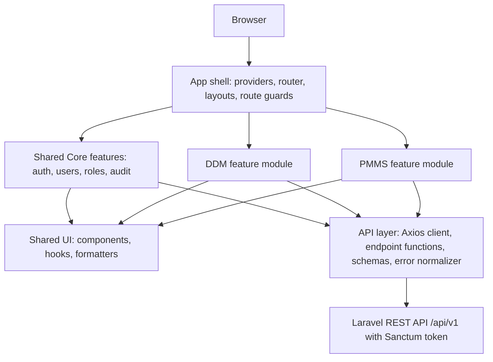
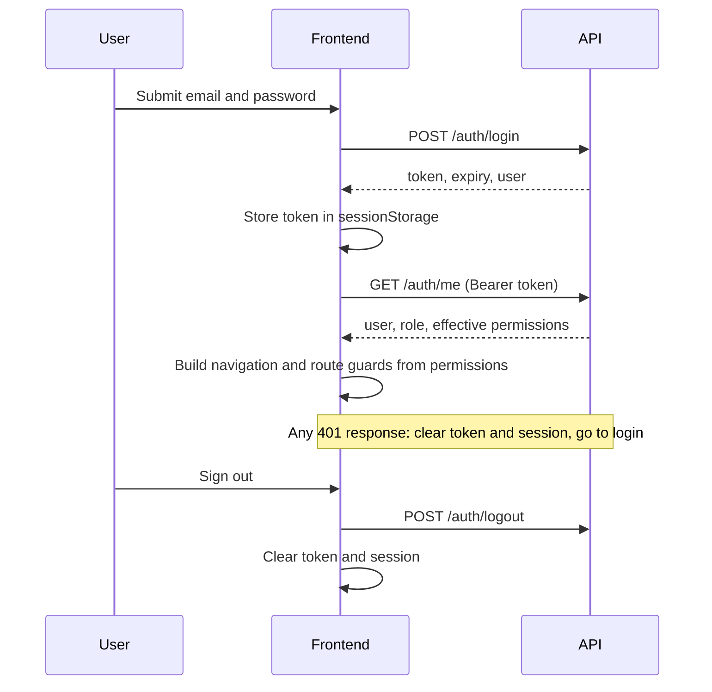

# Frontend Architecture — DDM-PMMS

**Status:** proposed. Items marked **(Proposed)** need the user's approval. Where the repository already has an established convention, the repository wins. If this file disagrees with `AGENTS.md`, `AGENTS.md` wins and this file must be corrected.

**Read with:** `AGENTS.md` (root rules), `ddm-pmms-backend.md` (final backend decisions), `api-contracts.md`, `design-system.md`, `frontend-guidelines.md`, `feature-specifications.md`, `development-workflow.md`.

## 1. Purpose and scope

This file defines how the DDM-PMMS frontend is structured: layers, module boundaries, state, authentication, authorization in the UI, errors, files, and routing. It does not define visuals (see `design-system.md`) or code style (see `frontend-guidelines.md`).

The frontend is a **thin client**. The backend decides who may do what and computes every business value. The frontend presents, collects input, and guides the user through the allowed actions.

## 2. Architectural principles

1. **The backend is the source of truth for security and business rules.** Hiding a button is a convenience, never protection.
2. **Mirror the platform.** The frontend has the same three areas as the backend: Shared Core, DDM, and PMMS. DDM and PMMS stay separate modules.
3. **Server state and client state are different things.** Server data lives in TanStack Query. Zustand holds only session and small UI state. Filters and pagination live in the URL.
4. **One typed boundary to the API.** Components never call Axios directly. They use feature hooks, which use typed endpoint functions.
5. **Never recompute backend values.** The indicator, `days_remaining`, `can_download`, effective access level, and the current version come from the API.
6. **Every data view has loading, empty, error, and forbidden states.**
7. **Small, vertical, verifiable slices.** A feature is built end to end (types, API, hooks, UI states, permissions, tests) before the next starts.

## 3. Layered architecture



**Import direction (enforced in review, by lint rule if the repo allows it):**

- `app` may import from `features` and `shared`.
- `features/*` may import from `shared` only, and from another feature only through that feature's `index.ts` (public API).
- `features/ddm` and `features/pmms` must not import from each other.
- `shared` imports nothing from `features` or `app`.

**Project documents.** The backend serves project supporting documents under `/pmms/...` and DDM documents under `/ddm/...`, and PMMS never calls DDM endpoints. The frontend follows this. Presentational pieces that both modules need (document table, version list, request-download dialog, upload form) live in `shared/components/documents` and receive their data and actions as props. Each module wires them to its own endpoints.

## 4. Folder structure (Proposed)

Use only if the repository has no established structure. Inspect the repository first.

```text
src/
  app/                 providers, router, layouts, route guards, error boundary
  shared/
    api/               axios client, interceptors, error normalizer, query client, pagination types
    auth/              session store, usePermission, <Can>, route guards
    components/        ui primitives and shared composites (DataTable, ReasonDialog, FileUpload,
                       HistoryTimeline, VersionList, StatusBadge, IndicatorBadge)
    hooks/             generic hooks (useDebounce, useUrlFilters)
    lib/               formatters (date, money, bytes), constants, enums
    types/             shared types
  features/
    auth/              login, change password
    users/             user administration, roles, per-user grants
    audit/             audit log viewer
    ddm/
      documents/  categories/  download-requests/  reports/
    pmms/
      projects/  progress/  history/  project-documents/  dashboard/  reports/
```

Each feature folder contains `api/`, `hooks/`, `components/`, `schemas/` (Zod), `types.ts`, `routes.tsx`, and `index.ts`.

## 5. State management

| Kind of state | Where it lives | Rule |
| --- | --- | --- |
| Server data (lists, details, history, dashboards) | TanStack Query | Never copy it into Zustand or `useState`. |
| Session (token, current user, permissions) | Zustand `authStore` | Only the token is persisted (see section 6). User and permissions are re-fetched from `GET /auth/me` on every app load. |
| List filters, sort, page, search | URL search params | Makes views shareable, survives refresh, and drives the query key. |
| Form state | React Hook Form + Zod | Schema lives with the feature. |
| Dialog open/close, selected rows, tabs | Local component state | Lift only when needed. |

**Query keys** use a factory per feature, for example `['pmms','projects','list', filters]`, `['pmms','projects','detail', id]`, `['ddm','documents','list', filters]`.

**Invalidation after mutations (examples):**

- Progress report: project detail, project history, project updates, project lists, dashboard, and watchlist.
- Pause or resume: the same set.
- Document version upload: document detail, version list, document lists.
- Download request decision: request lists, the affected document's detail (its `can_download` may change).

Optimistic updates are not used for lifecycle or approval actions. These must reflect the server's answer.

## 6. Authentication and session



**Decision 20 (final):** the Sanctum token is kept in `sessionStorage`. It survives a page refresh, is cleared when the tab closes, is cleared on logout and on any `401`, and is never logged or placed in a URL. Token expiry is 8 hours. Sanctum cookie-based SPA authentication would be stronger but is not adopted; raise it only if the user wants to revisit.

Consequences:

- Do not store the user object or permissions in storage. Re-fetch them so a role change takes effect on the next load.
- Downloads cannot use a plain link, because the token is not in the URL. Download through an authenticated request (see section 9).
- The login error message is generic. Show what the API returns and never reveal whether the email exists.
- Show a clear "session expired" message after a `401`, and return the user to the page they were on after signing in again, if it is safe to do so.

## 7. Authorization in the UI

- Read the role and **effective permissions** from `GET /auth/me`. Permission names follow `module.resource.action` (for example `ddm.documents.upload`). Never hardcode role names or role IDs in components.
- Provide three tools in `shared/auth`: `usePermission(name)`, `<Can permission="...">`, and a route guard that checks a permission before rendering a route.
- **Navigation** shows only areas the user can use. A Viewer with only DDM access sees no PMMS menu.
- **Actions** are hidden when the user lacks the permission, and the backend still decides. A `403` or `404` from the API is handled gracefully even for visible actions (the data may have changed).
- **Project ownership is not a permission.** A PE sees only his own projects because the API returns only those. Do not filter client-side, and do not assume the list is complete or shared.
- **Download ability** comes from the API's `can_download` flag, never from a role check.
- Admin and Super Admin cannot edit project data. They only see the administer actions (terminate, reopen, reassign, correct planned dates, delete, restore).

## 8. Error handling architecture

The Axios response interceptor converts every failure into one `ApiError` (`status`, `code`, `message`, `errors`). Components never inspect raw Axios errors.

| Status / code | UI behavior |
| --- | --- |
| `401` | Clear session, redirect to login with a "session expired" notice. |
| `403` | Show a not-allowed state. Code `download_approval_required` opens the request-download dialog. |
| `404` | Show a not-found state. An out-of-scope project is also `404`, so do not say "you do not have access". |
| `409` | Show the conflict message as a notice and refresh the data. |
| `422` | Map `errors` onto form fields. Show `message` for non-field problems. |
| `429` | Show a "too many attempts, try again shortly" notice. Disable the submit button briefly. |
| `500` / network | Show a generic error with a retry. Never display server internals. |
| `file_missing` | Show that the stored file could not be found and ask the user to contact an administrator. |

Use an error boundary per route so one failing screen does not blank the app. Use toasts for transient confirmations and inline messages for field and page errors.

## 9. Files: upload and download

- **Upload** uses `multipart/form-data` with progress. Client checks (type, size up to 50 MB) are hints only. The server decides. Accepted types: PDF, Word, Excel, PowerPoint, JPEG, PNG. Engineering plans are uploaded as PDF; DWG and other CAD files are rejected.
- **Download** goes through the authorized download endpoint with the Bearer token and a `blob` response type, then saves the file with the server's filename. Never build a storage path or a public URL. Never put the token in a URL.
- **Direct versus request.** If the document's `can_download` is true, offer Download. If false, offer Request download. If a download attempt returns `403 download_approval_required`, open the request dialog. Every download is audit-logged by the server.
- **Versions.** A new upload creates a new version. The UI must never suggest the old file is replaced or lost.

## 10. Routing map (Proposed)

| Route | Screen | Required permission |
| --- | --- | --- |
| `/login` | Login | Public |
| `/account/password` | Change own password | Signed in |
| `/pmms/dashboard` | Dashboard and watchlist | `pmms.dashboard.view` |
| `/pmms/projects` | Project list | `pmms.projects.view-all` or `view-own` |
| `/pmms/projects/new` | Register project | `pmms.projects.create` |
| `/pmms/projects/:id` | Project detail with tabs (overview, updates, history, documents) | view-all or owner |
| `/pmms/reports` | Project reports and export | `pmms.reports.view` |
| `/ddm/documents` | Document list and search | `ddm.documents.view` |
| `/ddm/documents/:id` | Document detail, versions | `ddm.documents.view` |
| `/ddm/download-requests` | My requests, approval queue | request or approve permission |
| `/ddm/categories` | Category management | `ddm.categories.manage` |
| `/ddm/reports` | DDM reports | `ddm.reports.view` |
| `/admin/users` | User administration | `users.manage` |
| `/admin/roles` | Roles and permissions | `roles.manage` |
| `/admin/audit-logs` | Audit trail | `audit.view` |

Routes are lazy-loaded per module so a user only downloads the code for areas they can open.

## 11. Performance and accessibility baselines

- Server-side pagination, sorting, and filtering everywhere. Never load a whole collection and filter in the browser.
- Debounce search inputs (about 300 ms) and cancel superseded requests.
- Lazy-load routes and the charting library.
- Meet WCAG 2.1 AA. Details are in `design-system.md`.

## 12. Testing architecture

Use the test tooling already installed. If none exists, propose Vitest, React Testing Library, and MSW for API mocking, which **(Proposed)** need approval before installing. What to test and how is in `frontend-guidelines.md`.

## 13. Open architectural decisions

These are listed in `development-workflow.md` section 11 and must be answered before the related work starts: UI library, test stack, API type generation, folder structure if the repo has none, currency and date display, and responsive scope.